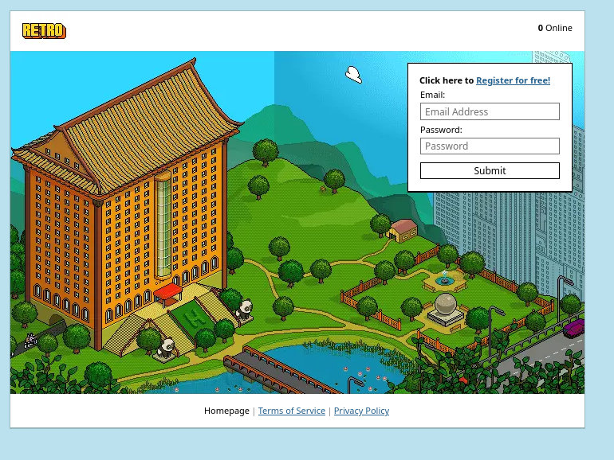
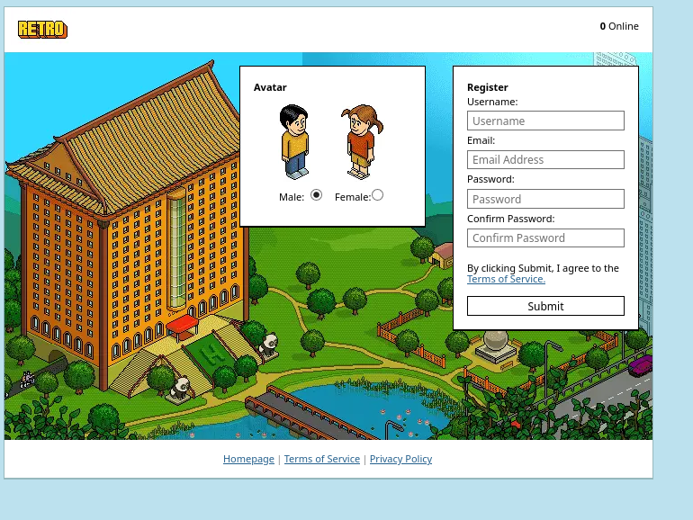
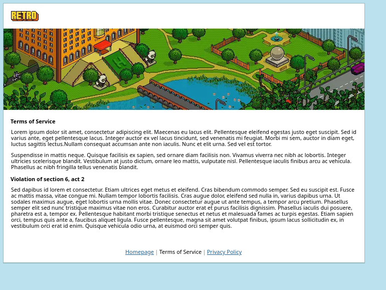
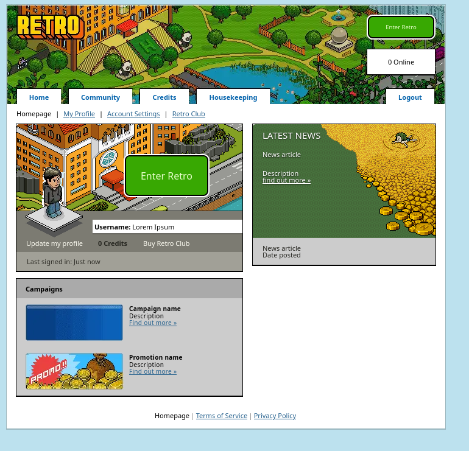
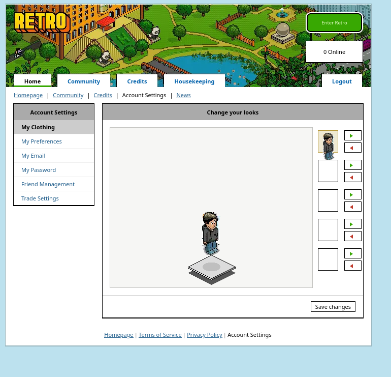
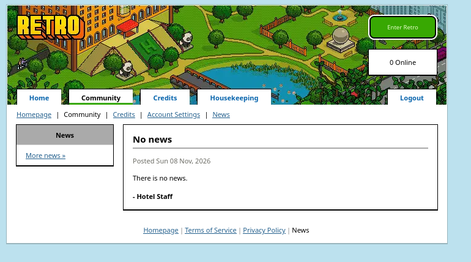
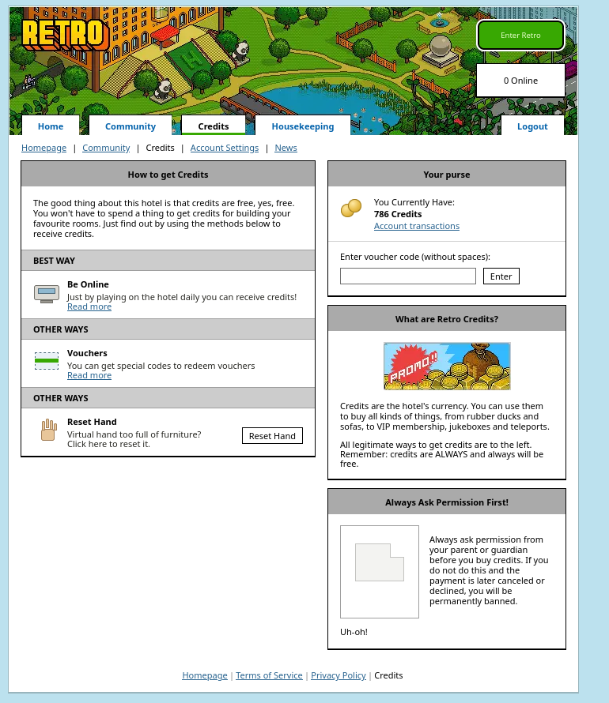

# PheonixPHP layout

I was bored so I recoded the PheonixPHP layout from screenshots...

A hand-coded recreation of the classic Phoenix hotel CMS front end: eight static pages laid
out on a fixed pixel grid, with every box, separator, navigation strip and button written as
real markup and real CSS. The bitmaps are limited to the isometric room art, the avatars and
the campaign graphics, so all the text is real HTML that you can select, search and
translate.

Open `index.html` and it works.

## Pages

| File | Body size | What is on it |
| --- | --- | --- |
| `index.html` | 753 x 557 | Login box, hero hotel view, footer links |
| `register.html` | 746 x 549 | Male/female avatar picker, registration form, terms checkbox |
| `terms.html` | 742 x 538 | Banner strip, terms of service copy |
| `dashboard.html` | 750 x 724 | Hotel view, profile plate, latest news, campaigns |
| `community.html` | 750 x 940 | Room lists: recommended, top rated, owned rooms |
| `credits.html` | 750 x 896 | Credit purchase methods, plans, promotion banner |
| `settings.html` | 750 x 698 | Account-settings sidebar, "change your look" figure |
| `news.html` | 750 x 417 | News inbox list |

## Screenshots

Seven captures taken from the built files.

### Home (`index.html`)



### Register (`register.html`)



### Terms of Service (`terms.html`)



### Hotel (`dashboard.html`)



### Account Settings (`settings.html`)



### News (`news.html`)



### Credits (`credits.html`)



## Running it

Any static server will do:

```sh
python3 -m http.server 8000
# then open http://localhost:8000/index.html
```

You can also open `index.html` straight from disk. All paths are relative.

## Source

Taken from: [PhoenixPHP - Theme Development (Multiple themes). - RaGEZONE - MMO...](https://web.archive.org/web/20200213000645/http://forum.ragezone.com/f331/phoenixphp-theme-development-multiple-themes-766586/)


## Fonts and fidelity

The layout was traced 1:1 from the reference mock-ups and reproduces their geometry,
colours and spacing exactly. Typography is the one variable: the design is set in Verdana
11 px, so `css/style.css` lists DejaVu Sans and Noto Sans after it as fallbacks. Measured against the mock-up, fewer than 1% of the front page's pixels
differ, and every difference is a one or two pixel fringe along a glyph edge, which is the
substitute font at work.

The one region that differs on purpose is the room view in the dashboard's profile box.
The brief asked for the Italian hotel view there, so that box shows `hotel_view_it.png` in
place of the room the mock-up was photographed with.

## Credits

Room art and campaign graphics come from the Phoenix PHP mock-up set. The Italian hotel
view and the plate the figure stands on come from the Habbo web-gallery assets
(`htlview_it.png`, `info_habbo_plate.png`).
